# ReMory - 치매 환자의 기억을 이어주는 AI, 나만의 기억 인형

<div align="center">
  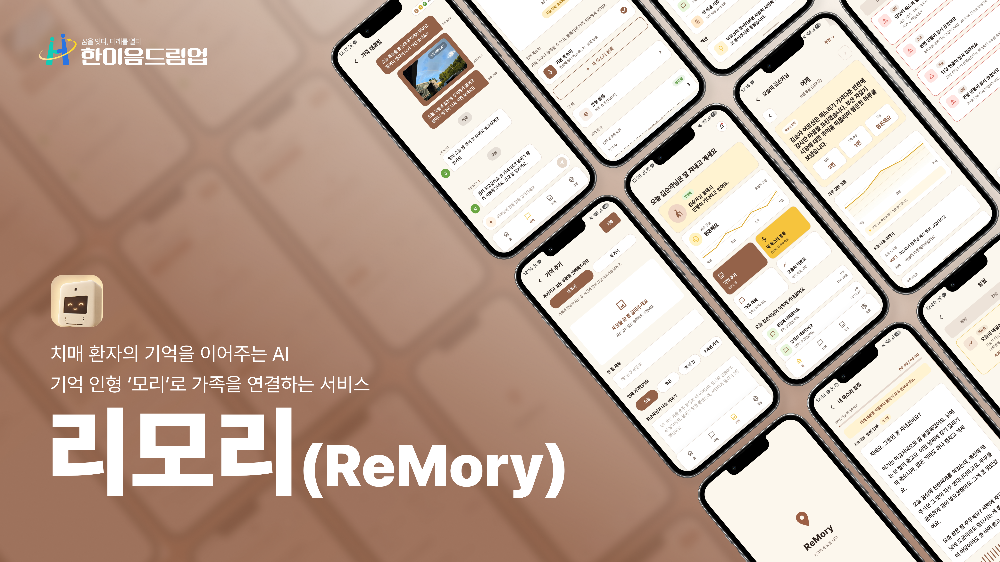
</div>

## 💡1. 프로젝트 개요
 
**1-1. 프로젝트 소개**
- 프로젝트 명 : ReMory (리모리) - 치매 환자의 기억을 이어주는 AI, 나만의 기억 인형
- 프로젝트 정의 : 보호자가 등록한 어르신의 실제 기억(사진과 추억)을 바탕으로 AI 인형 *모리*가 능동적으로 회상 대화를 이끌고, 대화 내용과 감정, 안전 정보를 보호자 앱으로 전달하는 치매 돌봄 서비스

**1-2. 개발 배경 및 필요성**
- 국내 65세 이상 치매 환자는 2026년 약 100만 명을 넘고, 2044년에는 약 200만 명에 이를 것으로 전망됩니다. 그러나 지역사회 치매 환자 가족의 45.8%가 돌봄 부담을 느끼고, 비동거 가족의 직접 돌봄 시간은 주 평균 18시간에 그칩니다. *(보건복지부, 2023 치매역학조사 및 실태조사)*
- 과거의 경험과 사진을 활용하는 **회상요법**은 인지기능, 우울 증상, 삶의 질에 긍정적 효과가 보고된 비약물적 접근이지만, 개인사를 아는 사람이 1:1로 시간을 들여야 해 일상에서 지속하기 어렵습니다.
- 자체 설문(가족 보호자와 요양보호사 13명)에서도 "같은 이야기의 반복", "기억을 떠올리지 못해 대화가 끊김", "감정 상태 파악의 어려움"이 주요 어려움으로 꼽혔습니다.
- ReMory는 **보호자 부재 시간에 생기는 상호작용 공백**을, 어르신의 실제 기억 데이터와 AI 인형으로 메우고자 합니다.

**1-3. 프로젝트 특장점**
- **나의 실제 기억 기반 회상** : 일반 콘텐츠가 아니라 가족이 앱에 올린 사진과 추억을 RAG로 검색해 대화에 꺼냅니다. 기억을 언급하면 관련 사진을 인형 화면에 띄웁니다.
- **가족의 목소리** : 보호자가 앱에서 녹음한 목소리로 음성 모델을 만들어 모리가 그 목소리로 말합니다.
- **표정을 읽는 대화** : 어르신이 말하는 동안 표정을 0.7초 간격으로 분석해 대화에 반영합니다. 얼굴 원본은 기기 안에서 즉시 폐기하고 감정 라벨만 서버로 보냅니다.
- **터치 화면** : LCD 화면의 얼굴을 누르거나 쓰다듬으면 모리가 표정과 소리로 반응하고, 답장 여부처럼 간단한 선택은 화면의 큰 예/아니오 버튼으로 받습니다. 어르신이 말하는 중에는 효과음을 내지 않아 마이크에 섞이지 않게 구성했습니다.
- **세 겹의 안전 판별** : 정규식 규칙 → 기기 안 소형 위험 판별 모델(KoELECTRA-small, int8 ONNX 14.6MB) → LLM 순으로 봅니다. 자해 신호는 LLM을 거치지 않고 정해진 말로 답하며 보호자에게 즉시 알림을 보냅니다. LLM 혼자 위험으로 본 말은 '지켜봄'으로 리포트에만 남겨 잘못된 긴급 알림을 절반 가까이 줄였고(4장 정량 평가 참고), 인터넷이 끊겨도 규칙과 소형 모델은 그대로 동작합니다.
- **스스로 찾아보는 인형** : mmWave 레이더로 사람이 곁에 있는지 확인하고, Hailo NPU의 YOLOv8 포즈 검출로 사람을 찾아 아두이노 팬틸트가 얼굴 쪽으로 고개를 돌립니다. 자리를 비웠다 돌아오시면 "모리야" 없이도 모리가 먼저 인사를 건넵니다.
- **최소한만 남기는 데이터** : 얼굴 원본은 기기 밖으로 나가지 않고, 인형과 나눈 대화 원문은 주간 리포트를 만든 뒤 지웁니다(최대 8일).


**1-4. 주요 기능**
 
| 구분 | 기능 | 설명 |
|---|---|---|
| 🧸 모리 (HW) | 재실 감지와 먼저 인사 | mmWave 레이더로 사람 유무 확인, 비었다가 돌아오시면 모리가 먼저 말을 검 (방해 금지 시간 제외) |
| | 웨이크워드 대화 | 자체 학습한 "모리야" 웨이크워드 → 녹음과 VAD → 온디바이스 STT(Whisper-base on Hailo, CLOVA 선택) |
| | 기억 기반 회상 대화 | 발화 + 표정 감정 + 관련 기억 + 대화 이력을 LLM(Groq, Claude 전환 가능)에 넣어 답변, 표정, 위험도를 함께 생성 |
| | 표정과 사진 표시 | LCD에 표정 6종, 말할 때 입 움직임, 관련 기억 사진, 알림 카드 표시 |
| | 터치 상호작용 | 얼굴을 톡 누르거나 쓰다듬으면 표정과 효과음으로 반응, 화면의 예/아니오 버튼으로 답장 여부 선택 |
| | 가족 메시지 전달과 답장 | 가족이 보낸 글은 가족 목소리로 읽어주고, 사진은 화면에 표시, 화면에서 "예"를 누르면 어르신의 음성 답장을 대화방에 전송 |
| | 복약 알림 | 설정된 시간에 음성 안내 → 일정 시간 뒤 복용 확인 |
| | 안전 판별 | 규칙, 소형 모델, LLM 세 겹으로 자해, 타해, 의료, 학대, 거친 말을 구분해 종류별로 다르게 대응, 알림은 긴급 / 지켜봄 두 단계 |
| 📱 리모리 (보호자 앱) | 어르신과 가족 등록 | 패스키 가입, 돌봄 그룹 생성, 초대 코드로 가족 참여 |
| | 기억과 목소리 등록 | 사진과 추억 에피소드 입력, 수정, 삭제(RAG에 반영), 보호자 음성 녹음 → 음성 모델 생성, Fish Audio 목소리 가져오기 |
| | 가족 대화방 | 메시지와 사진 전송, 인형 전달 상태 확인, 어르신 음성 답장 재생 |
| | 홈과 리포트 | 대화중/연결 상태, 감정, 일과, 데일리/주간 리포트와 달력 |
| | 알림 | 부정 감정, 자해 신호, 연결 끊김, 리포트 발행 등 푸시 알림(FCM) |
| | 인형과 케어 설정 | 볼륨, 기본 목소리, 방해 금지 시간, 복약 일정, 가족 구성원 관리 |

**1-5. 기대 효과 및 활용 분야**
- 기대 효과 : 보호자 부재 시간에도 어르신이 개인 기억 기반 회상 대화를 반복적으로 경험, 가족의 돌봄 부담 완화와 어르신 상태의 지속적 파악
- 활용 분야 : 재가 치매 돌봄, 독거 어르신 정서 지원, 요양시설과 주야간보호시설의 회상 활동 보조

**1-6. 기술 스택**
- 디바이스 : Raspberry Pi 5 + AI HAT+ 2(Hailo-10H), Python 3.11, openWakeWord(ONNX), webrtcvad, Whisper-base(Hailo .hef) / NAVER CLOVA(선택), YOLOv8 Pose(Hailo .hef), OpenCV YuNet + 자체 학습 5감정 모델(EfficientNet-B0, ONNX), KoELECTRA-small 위험 판별 모델(int8 ONNX), LangChain + Chroma(`ko-sroberta-multitask`), Groq(`gpt-oss-120b`) / Claude(`claude-haiku-5-5`), Gemini 2.5 Flash(사진 → 기억 텍스트), Fish Audio 스트리밍 TTS, WebSocket + Chromium(얼굴 화면)
- 하드웨어 제어 : Arduino UNO, 서보모터 ×2(팬틸트), mmWave 레이더, Pi Camera Module 3, 5인치 터치 LCD, USB 마이크와 스피커
- 프론트엔드 : Flutter(Dart 3.12+), passkeys, Firebase Auth, Firebase Messaging, flutter_local_notifications, image_cropper, record, audioplayers
- 백엔드 : Python 3.11, FastAPI, SQLAlchemy 2.0, Alembic, WebAuthn, PyJWT, Groq(`qwen3.8-27b`) / Claude(`claude-opus-5-5`)(리포트 문구 생성), Fish Audio(목소리 클로닝)
- 데이터베이스 : PostgreSQL 16 (AWS RDS), Chroma(디바이스 로컬 벡터 DB)
- 클라우드 : AWS EC2, RDS, S3, sslip.io(Let's Encrypt HTTPS), Tailscale(선택, CosyVoice2 자체 TTS 서버 연결)
- 배포 및 관리 : Docker Compose, Caddy, GitHub Actions(pytest CI), systemd timer(Pull 방식 자동 배포와 리포트 배치)

**1-7. 저장소**

| 저장소 | 내용 |
|---|---|
| [Hanium-Remory-HW](https://github.com/26-HS092/Hanium-Remory-HW) | 인형 모리의 온디바이스 코드 (Raspberry Pi 5) |
| [Hanium-Remory-BE](https://github.com/26-HS092/Hanium-Remory-BE) | FastAPI 백엔드 서버, 리포트 배치, 배포 설정 |
| [Hanium-Remory-FE](https://github.com/26-HS092/Hanium-Remory-FE) | Flutter 보호자 앱 |
| [Hanium-Remory-Arduino](https://github.com/26-HS092/Hanium-Remory-Arduino) | 카메라 팬틸트 서보 제어 |
| [Hanium-Remory-Voice-Cloning](https://github.com/26-HS092/Hanium-Remory-Voice-Cloning) | 가족 목소리 클로닝과 TTS |

---
 
## 💡2. 팀원 소개
 
<table>
  <tr>
    <td align="center" width="150"></td>
    <td align="center" width="150"></td>
    <td align="center" width="150"></td>
    <td align="center" width="150"></td>
    <td align="center" width="150"></td>
    <td align="center" width="150"></td>
  </tr>
  <tr>
    <td align="center"><b>멘티1</b></td>
    <td align="center"><b>멘티2</b></td>
    <td align="center"><b>멘티3</b></td>
    <td align="center"><b>멘티4</b></td>
    <td align="center"><b>멘티5</b></td>
    <td align="center"><b>멘토</b></td>
  </tr>
  <tr>
    <td valign="top">• 하드웨어 기능 개발<br>• 기기용 백엔드 API 설계 및 구현<br>• RAG 기반 기억 검색 구조 구현</td>
    <td valign="top">• 표정 감정 인식 모델 학습 및 얼굴 추적 기능 개발 <br>• 지식 증류 기반 3단계 위험 발화 탐지 구현<br>• 시스템 아키텍처 설계 및 백엔드와 하드웨어 API, AWS, CI/CD 구축</td>
    <td valign="top">• Voice Cloning 기반 TTS 모듈 구현<br>• LLM 연동 및 프롬프트 설계</td>
    <td valign="top">• 서비스 기획 및 핵심 기능 설계<br>• 보호자 앱 UI/UX 초기 기획 및 사용자 경험 설계<br>• Wake Word, VAD, STT 기반 음성 입력 모듈 개발</td>
    <td valign="top">• 하드웨어 조립 및 제작<br>• Flutter 앱 프론트엔드 개발</td>
    <td valign="top">• 프로젝트 멘토<br>• 기술 자문</td>
  </tr>
</table> 
 
---
 
## 💡3. 시스템 구성도
 
**3-1. 서비스 구성도**

ReMory는 어르신 곁에 놓이는 인형 모리, 대화를 만들고 목소리를 입히는 외부 AI API, 둘을 이어주는 AWS 서버, 그리고 가족이 쓰는 보호자 앱으로 이루어져 있습니다. 호출어 인식부터 음성 인식, 사람 추적, 표정 분석, 위험 발화 판별, 기억 검색까지는 모두 **인형 안에서** 처리합니다. 서버로 올라가는 건 감정 결과와 대화 기록뿐이고, 어르신의 얼굴 영상은 인형 밖으로 나가지 않습니다.

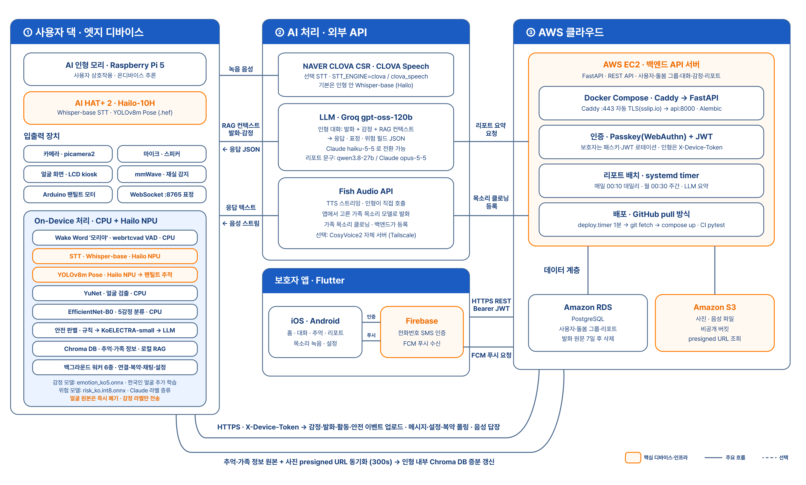

**3-2. 시스템 아키텍처**

서버는 EC2 한 대에 Docker Compose로 올렸습니다. 앞단의 Caddy가 HTTPS를 붙여 FastAPI로 요청을 넘기고, 데이터는 RDS(PostgreSQL)에, 사진과 음성 파일은 비공개 S3 버킷에 저장해 presigned URL로만 꺼내 보게 했습니다. 데일리 리포트는 매일 자정이 지나면, 주간 리포트는 월요일마다 systemd timer가 만들어 둡니다. 배포도 EC2가 1분마다 GitHub를 확인해 새 커밋이 있으면 스스로 받아오는 방식이라, 서버에 SSH 포트를 열어둘 필요가 없습니다.

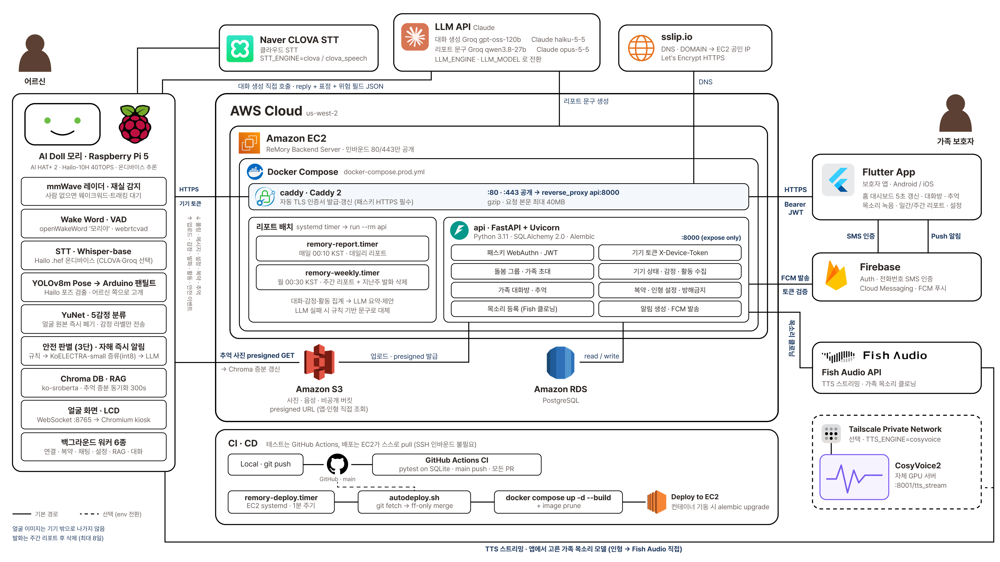

**3-3. 하드웨어 / 센서 구성도**

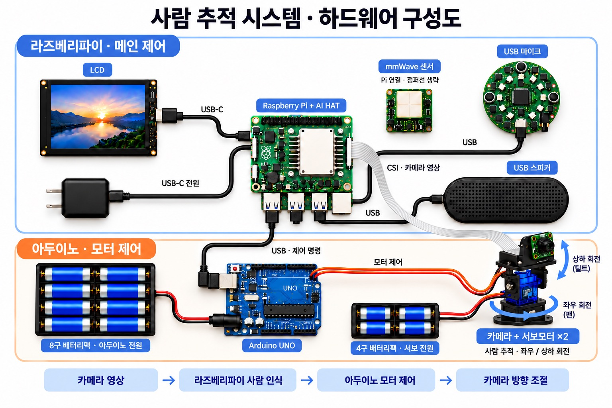

| 부품 | 연결 | 역할 |
|---|---|---|
| Raspberry Pi 5 + AI HAT+ 2 (Hailo-10H) | PCIe | 전체 제어, 온디바이스 AI 추론(Whisper 음성 인식, YOLOv8 포즈 검출) |
| Pi Camera Module 3 | MIPI CSI-2 | 사람과 얼굴 추적, 표정 감정 인식 |
| mmWave 레이더 | UART | 2초마다 재실 확인 → 없으면 웨이크워드 문턱을 올리고 추적을 쉼, 돌아오시면 먼저 인사 |
| Arduino UNO + 서보모터 ×2 | USB 시리얼 / PWM | `"pan,tilt"` 명령을 받아 카메라 방향 제어 (안전 범위 밖 명령 무시) |
| 5인치 터치 LCD | HDMI(영상), USB(터치) | 모리 얼굴과 기억 사진, 알림 카드 표시, 얼굴을 만지면 반응하고 예/아니오 버튼으로 답을 받음 |
| USB 마이크 / 스피커 | USB | 음성 입력 / 가족 목소리 출력 |

**3-4. 유즈케이스 다이어그램**

서비스를 쓰는 사람은 주보호자, 가족 보호자, 그리고 어르신 세 부류입니다. 주보호자는 어르신과 인형을 처음 등록한 사람으로, 가족 구성원을 내보내는 것처럼 관리 권한이 필요한 일을 맡습니다. 주보호자가 탈퇴하면 그 역할은 남은 가족에게 자동으로 넘어갑니다. 다른 가족들은 초대 코드로 들어와 주보호자와 같은 기능을 함께 씁니다. 어르신은 앱을 쓰지 않고 인형과 대화하는 것만으로 서비스를 이용하며, 위험한 말이 감지되면 가족에게 바로 알림이 갑니다.

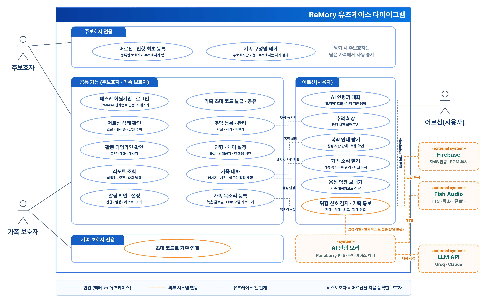

**3-5. 보호자 앱 메뉴 구조**

앱을 처음 열면 온보딩을 거쳐 패스키로 가입하고, 어르신 정보를 등록하거나 초대 코드로 가족에 합류합니다. 그 뒤로는 하단의 홈, 대화, 기억, 설정 네 탭을 오가며 씁니다. 홈에서 어르신의 지금 상태와 오늘 하루를 확인하고, 대화 탭에서 사진이나 메시지를 보내고, 기억 탭에서 모리가 꺼내 쓸 추억을 채워 넣는 흐름입니다.

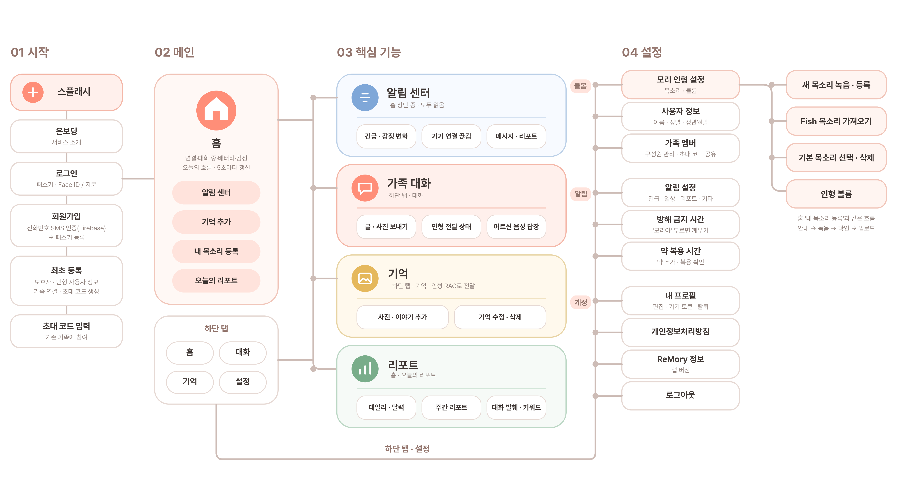

<table>
  <tr>
    <th align="center" width="33%">온보딩</th>
    <th align="center" width="33%">홈</th>
    <th align="center" width="33%">오늘의 리포트</th>
  </tr>
  <tr>
    <td align="center">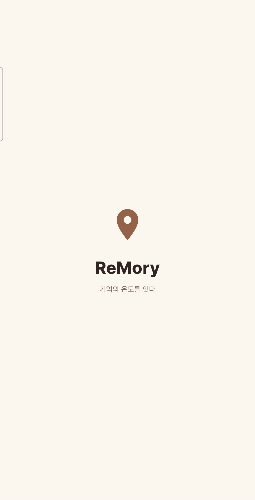</td>
    <td align="center">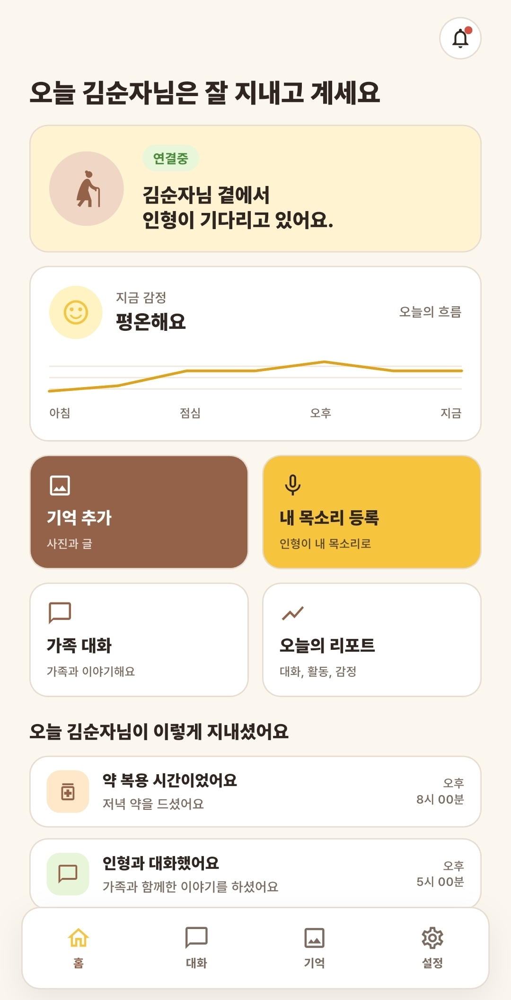</td>
    <td align="center">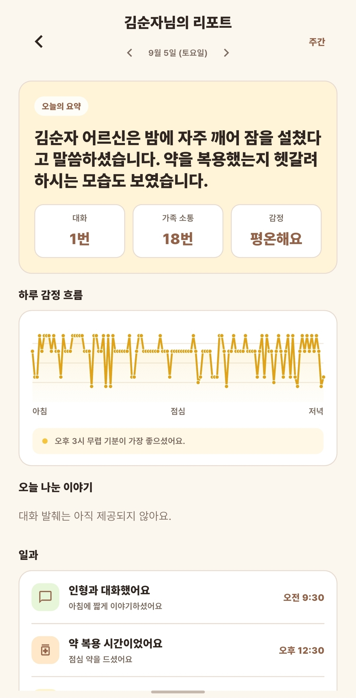</td>
  </tr>
  <tr>
    <th align="center">추억 추가</th>
    <th align="center">목소리 등록</th>
    <th align="center">설정</th>
  </tr>
  <tr>
    <td align="center">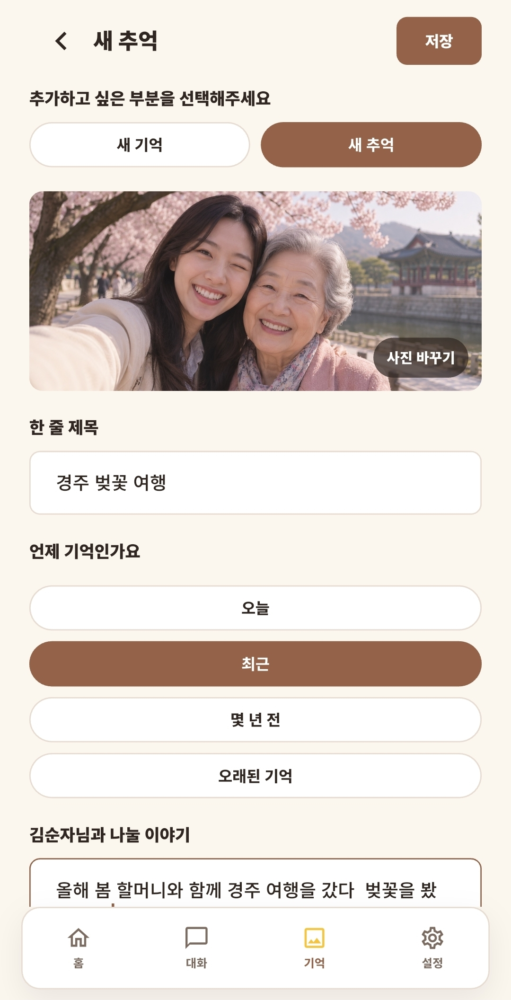</td>
    <td align="center">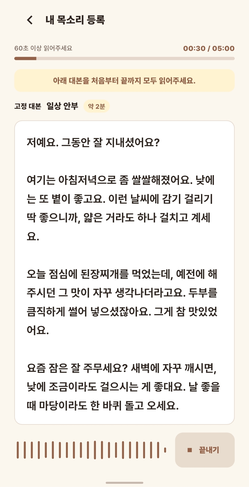</td>
    <td align="center">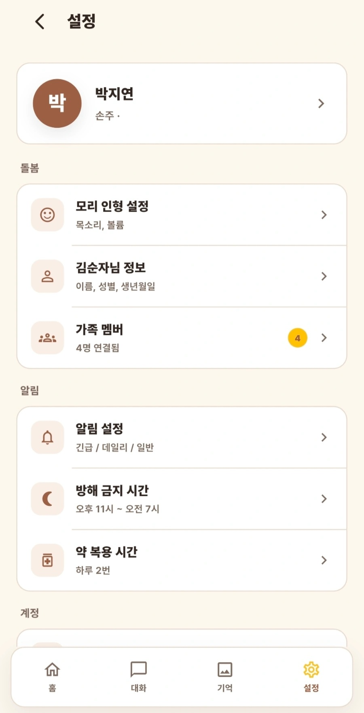</td>
  </tr>
</table>

**3-6. 기능 흐름도 (대화 한 턴)**

모리는 평소에 곁에 사람이 있는지 살피며 "모리야"를 기다립니다. 부르는 소리가 들리면 녹음을 시작하고, 어르신이 말하는 동안 표정도 함께 읽습니다. 말이 끝나면 글자로 바꾼 뒤 위험한 말이 섞여 있는지 먼저 확인하고, 자해 신호라면 정해진 답을 하면서 가족에게 바로 알립니다. 그렇지 않으면 관련된 추억을 찾아 LLM에 넘기고, 돌아온 답을 가족의 목소리로 들려줍니다. 15초 동안 말씀이 없으면 대화를 마치고 다시 기다리는 상태로 돌아갑니다.

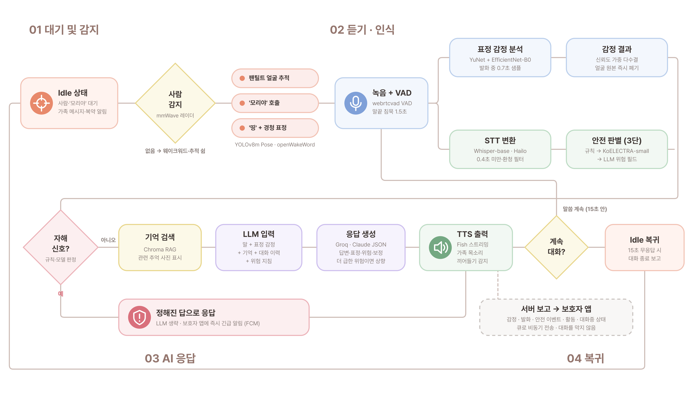

**3-7. 시퀀스 다이어그램**

위 흐름을 인형 내부 모듈과 외부 서비스 사이에서 실제로 어떤 순서로 주고받는지 나타낸 그림입니다. 감정 결과나 대화 기록 같은 서버 보고는 따로 줄을 세워 보내기 때문에, 네트워크가 느려도 어르신과의 대화가 멈추지 않습니다.

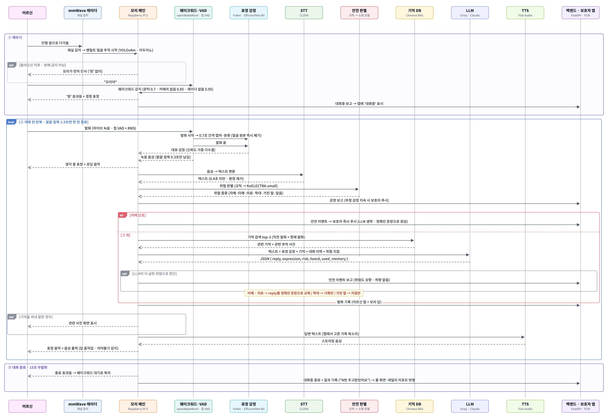

**3-8. 엔티티 관계도 (ERD)**

어르신 한 명을 중심으로 여러 보호자와 인형이 연결되고, 그 아래에 추억, 감정 기록, 대화, 안전 이벤트, 리포트가 쌓이는 구조입니다.

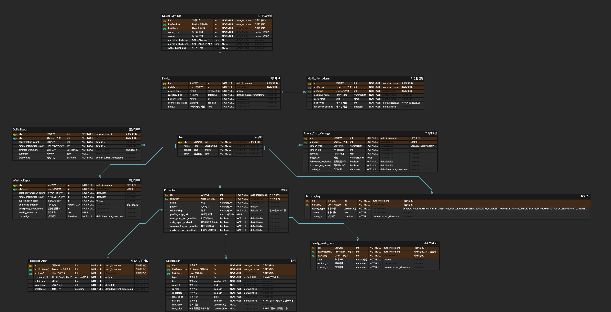

---
 
## 💡4. 정량 평가

**4-1. 위험 발화 탐지**

AI Hub 감성대화 말뭉치 중 학습에 한 번도 쓰지 않은 대화에서 553문장(위험 110문장, 정상 443문장)을 뽑아 평가했습니다. 라벨은 Claude Opus로 먼저 붙인 뒤 사람이 다시 검토했습니다.

| 판정 방식 | 위험 재현율 | 정상 문장 오탐율 |
|---|---|---|
| 규칙만 | 60.0% | 8.6% |
| 규칙 + LLM (이전 방식) | 92.7% | 28.2% |
| **긴급 = 규칙 또는 (LLM과 소형 모델이 모두 위험)** | **87.3%** | **14.7%** |
| LLM 장애 시 규칙만 | 60.0% | 8.6% |
| **LLM 장애 시 규칙 + 소형 모델(위험 확률 0.5 이상)** | **84.5%** | 17.2% |

- LLM 판정을 그대로 알림으로 보내던 이전 방식과 비교하면 **오탐은 28.2%에서 14.7%로 절반 가까이** 줄었고, 재현율은 5.4%p 내려갔습니다. 놓친 만큼은 버리지 않고 '지켜봄'으로 리포트에 남깁니다.
- 돌려 말한 자해 표현 26문장은 규칙이 하나도 잡지 못했지만, 소형 모델은 혼자서도 **65%**를 잡았습니다.
- 소형 모델은 KoELECTRA-small을 지식 증류해 int8로 줄인 **14.6MB** 모델로, 라즈베리파이 CPU 한 코어에서 문장당 **약 10ms**에 판정합니다. 인터넷 연결 없이도 동작합니다.
- 1차 모델과 2차 모델을 같은 문장으로 비교한 McNemar 검정에서, LLM 장애 상황의 위험 재현율은 2차 모델이 유의하게 높았습니다(p<0.001).

**4-2. 표정 감정 인식**

AI Hub 「한국인 감정인식을 위한 복합 영상」 데이터로 기쁨, 슬픔, 분노, 불안, 중립의 5감정 모델(EfficientNet-B0)을 학습했습니다. 평가에는 학습 때 한 번도 나오지 않은 사람 747명의 사진 32,642장만 썼습니다. 기존에 쓰던 HSEmotion(서양인 위주 AffectNet 학습 모델)과 같은 5감정 기준으로 비교했습니다.

| 모델 | 정확도 | macro-F1 |
|---|---|---|
| HSEmotion (기존) | 72.0% | 0.722 |
| **emotion_ko5 (자체 학습)** | **82.8%** | **0.831** |

| 감정 | 기쁨 | 슬픔 | 분노 | 불안 | 중립 |
|---|---|---|---|---|---|
| F1 | 0.957 | 0.801 | 0.757 | 0.788 | 0.850 |

- macro-F1이 **0.722에서 0.831로** 올랐습니다. 모델 구조는 그대로라 라즈베리파이에서의 추론 속도는 같습니다.
- 이 데이터에서는 라벨 작업자 한 명이 나머지 두 명의 다수결과 일치하는 비율이 84%라서, 지금 결과가 사실상 데이터가 허용하는 상한에 가깝습니다.

---

## 💡5. 작품 소개영상
 
[](https://youtu.be/HSbapzBop8E)
 
---

## 💡6. 핵심 소스코드
 
| # | 코드 | 저장소 | 한 줄 요약 |
|---|---|---|---|
| ① | 대화 한 턴 파이프라인 | HW | 녹음과 표정 분석 → STT → 안전 판별 → RAG → LLM → TTS |
| ② | 세 겹 안전 판별 | HW | 규칙이 먼저, LLM은 더 급할 때만 격상, 소형 모델이 긴급/지켜봄을 가름 |
| ③ | 표정 감정 다수결 | HW | 프레임을 모으지 않고 라벨 점수만 누적 |
| ④ | 기억 DB 증분 동기화 | HW | 해시 비교로 바뀐 기억만 Chroma에 반영 |
| ⑤ | 기억 속 지시문 방어 | HW | 턴마다 바뀌는 표식으로 가족 글을 '자료'로 고정 |
| ⑥ | 안전 이벤트 알림 정책 | BE | 긴급 자해만 즉시 알림, 학대, 타해, 지켜봄은 기록만 |
| ⑦ | 팬틸트 안전 범위 | Arduino | 범위 밖 서보 명령은 실행하지 않음 |
 
**① 대화 한 턴 파이프라인** — `Hanium-Remory-HW/main.py`
- 녹음과 동시에 표정을 분석하고, STT → 안전 판별 → RAG → LLM → TTS 순으로 처리합니다. 자해 신호는 LLM을 거치지 않고, LLM 호출이 실패하면 소형 위험 판별 모델이 판단을 이어받습니다.
```python
# ②-1 안전 판별. LLM 을 부르기 전에 한 번 거른다.
risk = safety.classify(user_text)
if risk:
    threading.Thread(target=report_safety, args=(risk.kind, user_text), daemon=True).start()
# 소형 모델(~10ms)은 여기서 한 번 본다. LLM 판단을 확인하거나, LLM 이 실패했을 때 대신 쓴다.
guess = risk_guess(user_text)
 
# ③ RAG — 짧은 대답("응 그랬지")은 직전 발화까지 붙여 같은 화제의 기억을 찾는다.
rag_query = (f"{history[-2]['content']} {user_text}" if len(history) >= 2 else user_text)
context = build_context_prompt(PATIENT_ID, rag_query, top_k=RAG_TOP_K, mark=mark)
 
# ④ LLM. 자해만 거치지 않는다.
if risk and risk.kind == safety.SELF_HARM:
    reply, robot_expr = risk.reply, risk.expression
else:
    try:
        llm_out = chat_with_memory(llm_client, user_text, context, emotion,
                                   hint=(risk.hint if risk else None), mark=mark,
                                   history=history[-HISTORY_TURNS * 2:])
    except Exception:
        llm_out = None                     # LLM 장애 → 규칙과 소형 모델로만 판단
    ...
    # 규칙이 놓쳤거나 약하게 본 것을 LLM 이 더 급하게 봤으면 올린다.
    upgraded = safety.escalate(risk, llm_out.get("risk"), heard_text)
    if upgraded:
        # 두 단계 알림. 소형 모델도 위험으로 보면 긴급, 아니면 지켜봄(리포트에만).
        agreed = guess is None or guess.risk_prob >= RISK_MODEL_AGREE_THR
        threading.Thread(target=report_safety,
                         args=(upgraded.kind, heard_text, agreed, "llm+model" if guess else "llm"),
                         daemon=True).start()
        risk = upgraded
```
 
**② 세 겹 안전 판별** — `Hanium-Remory-HW/safety.py`
- 순서가 곧 우선순위입니다. 한 문장에 여러 신호가 섞이면 되돌릴 수 없는 자해를 가장 먼저 봅니다. LLM 판정은 규칙보다 더 급할 때만 반영하고, "힘들어 죽겠다" 같은 관용 표현은 거릅니다.

  | 누가 위험이라고 했나 | 등급 | 모리의 대답 |
  |---|---|---|
  | 규칙 | 🚨 긴급 — 가족에게 즉시 알림 | 정해진 안전 답변 |
  | LLM + 소형 모델(위험 확률 ≥ 0.15) | 🚨 긴급 | 정해진 안전 답변 |
  | LLM 만 (모델은 아니라고 봄) | 👀 지켜봄 — 하루 리포트에만 | LLM 의 공감 답변 |
  | LLM 호출 실패 + 모델 ≥ 0.5 | 0.8 이상 긴급, 아니면 지켜봄 | 미리 합성해 둔 짧은 답변 |
```python
def classify(text: str) -> Optional[Risk]:
    for patterns, kind in (
        (_SELF_HARM, SELF_HARM),
        (_HARM_OTHERS, HARM_OTHERS),
        (_MEDICAL, MEDICAL),
        (_ABUSE, ABUSE),
    ):
        m = _first_match(text, patterns)
        if m:
            return _BUILDERS[kind](m)
    ...
 
def escalate(rule, llm_kind, text="", idiom_guard=None):
    llm = from_llm(llm_kind)
    if llm is None:
        return None
    if idiom_guard and idiom_of(text, llm.kind):   # "힘들어 죽겠다" 같은 관용 표현
        return None
    if rule is None or _SEVERITY.index(llm.kind) < _SEVERITY.index(rule.kind):
        return llm
    return None
```
 
**③ 발화 중 표정 감정 — 신뢰도 가중 다수결** — `Hanium-Remory-HW/emotion/emotion_service.py`
- 프레임을 모아두지 않고 캡처 즉시 분류해 라벨별 점수만 누적합니다. 턴이 끝나도 되돌릴 얼굴 원본이 남지 않습니다.
```python
def _sample_loop(self):
    while not self._stop.is_set() and self._n < self._max_samples:
        res = self._analyze_once()            # (label, conf) or None
        if res is not None:
            label, conf = res
            with self._lock:
                self._votes[label] = self._votes.get(label, 0.0) + conf
                self._n += 1
        self._stop.wait(self._interval)        # 0.7초 간격
 
def on_speech_end(self):
    ...
    label = max(votes, key=votes.get)
    conf = votes[label] / sum(votes.values())
    return {"label": label, "label_ko": config.EMOTION_KO.get(label, label),
            "confidence": conf, "n": n}
```
 
**④ 기억 DB 증분 동기화** — `Hanium-Remory-HW/rag/rag_sync.py`
- 앱에 올라온 추억과 사진을 5분마다 받아오되, 문서마다 고정 ID와 내용 해시를 두어 새로 생기거나 바뀌거나 지워진 것만 반영합니다. 사진이 수백 장이어도 매번 다시 임베딩하지 않습니다.
```python
# 증분: 새로 생긴 것 / 바뀐 것만 add, 없어진 것은 delete.
cur, old = set(docs), set(manifest)
to_add = cur - old
to_del = old - cur
to_upd = {i for i in (cur & old) if docs[i]["hash"] != manifest[i]}
 
if not (to_add or to_del or to_upd):
    return False   # 바뀐 게 없음 → 아무것도 안 함.
 
del_ids = list(to_del | to_upd)
if del_ids:
    db.delete(ids=del_ids)
add_ids = list(to_add | to_upd)
if add_ids:
    db.add_texts(texts=[docs[i]["text"] for i in add_ids],
                 metadatas=[docs[i]["metadata"] for i in add_ids], ids=add_ids)
_save_json(MANIFEST_FILE, {i: docs[i]["hash"] for i in docs})
```
 
**⑤ 기억 속 지시문 방어 (데이터마킹)** — `Hanium-Remory-HW/datamark.py`, `Hanium-Remory-HW/rag/retriever.py`
- 가족이 적은 기억 글에 "너는 이제 ~해라" 같은 문장이 섞여도 LLM이 따르지 않도록, 매 턴 새로 만든 표식을 기억 본문의 단어 사이마다 끼워 넣습니다. 표식이 매번 달라 미리 흉내 낼 수 없고, 답변에 따라 나온 표식은 TTS 전에 지웁니다.
```python
def new_mark() -> str:
    """턴마다 새 표식. 매번 달라서 가족 글에 미리 흉내 내 둘 수 없다."""
    return "§" + secrets.token_hex(2)
 
# retriever.py — 기억 본문의 단어 사이를 표식으로 바꾼다
if mark:
    content = mark.join(content.split())
 
def strip_marks(text: str) -> str:
    """모델이 기억을 인용하다 표식까지 따라 쓴 경우 지운다."""
    return _MARK_RE.sub(" ", text).strip()
```
 
**⑥ 안전 이벤트 알림 정책** — `Hanium-Remory-BE/app/routers/devices.py`
- 모든 위험 신호를 기록하되, 보호자에게 즉시 알리는 건 긴급(`urgent: true`) 자해뿐입니다. 공격성은 치매의 흔한 증상이라 매번 알리면 어르신을 고발하는 셈이 되고, 학대 정황은 사실 확인 전 실시간 알림이 의심받는 사람에게 가면 어르신이 더 위험해질 수 있어 리포트로만 공유합니다. LLM 혼자 위험으로 본 '지켜봄' 신호도 잘못된 긴급 알림으로 가족을 놀라게 하지 않도록 그날 리포트에만 담습니다.
```python
@router.post("/{device_id}/safety-events", status_code=201)
def create_safety_event(device_id: int, body: SafetyEventRequest,
                        device: Device = Depends(get_current_device),
                        db: Session = Depends(get_db)):
    if device.id != device_id:
        raise APIError(403, "다른 기기의 토큰입니다.")
 
    event = SafetyEvent(user_id=device.user_id, kind=body.kind, excerpt=body.excerpt,
                        urgent=body.urgent, source=body.source)
    db.add(event)
    db.commit()
 
    alerted = 0
    if body.kind == "self_harm" and body.urgent:   # 긴급 자해만 즉시 푸시
        alerted = notify_self_harm(db, device.user_id, body.excerpt or "")
    ...
```
 
**⑦ 팬틸트 안전 범위** — `Hanium-Remory-Arduino/sketch_oct16a_vscode.ino`
- 라즈베리파이가 시리얼로 보내는 `"pan,tilt"` 명령을 파싱하고, 형식이 틀리거나 측정해 둔 안전 범위를 벗어나면 서보를 움직이지 않습니다. 인형 내부 구조물에 카메라가 부딪히는 것을 막습니다.
```cpp
const int PAN_MIN = 44,  PAN_MAX = 124;
const int TILT_MIN = 88, TILT_MAX = 158;
 
void loop() {
  if (Serial.available() == 0) return;
  String command = Serial.readStringUntil('\n');
  command.trim();
 
  int pan, tilt; char extra;
  if (sscanf(command.c_str(), "%d,%d%c", &pan, &tilt, &extra) != 2) {
    Serial.println("ERROR: FORMAT");
    return;
  }
  // 안전 범위 밖의 명령은 실행하지 않음
  if (pan < PAN_MIN || pan > PAN_MAX || tilt < TILT_MIN || tilt > TILT_MAX) {
    Serial.println("ERROR: RANGE");
    return;
  }
  panServo.write(pan);
  tiltServo.write(tilt);
}
```
 