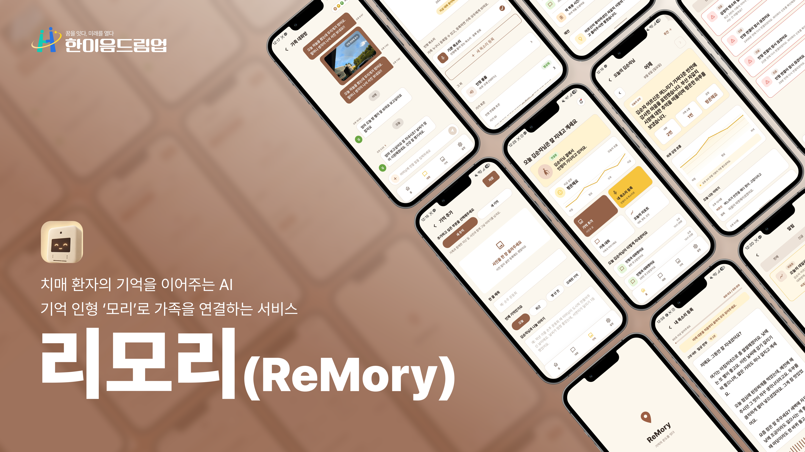
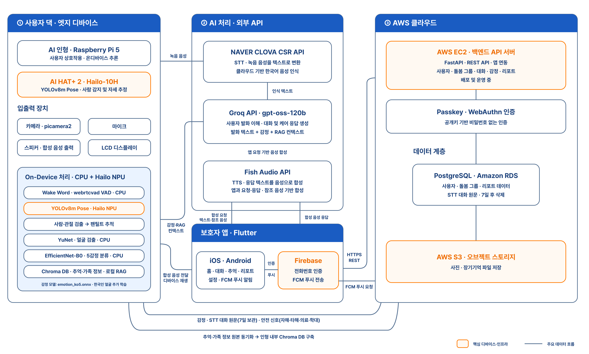
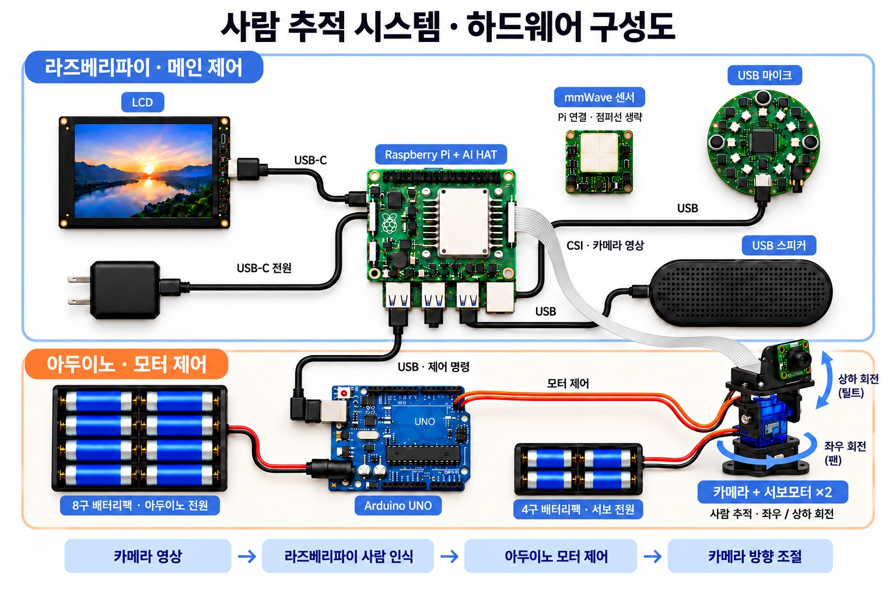
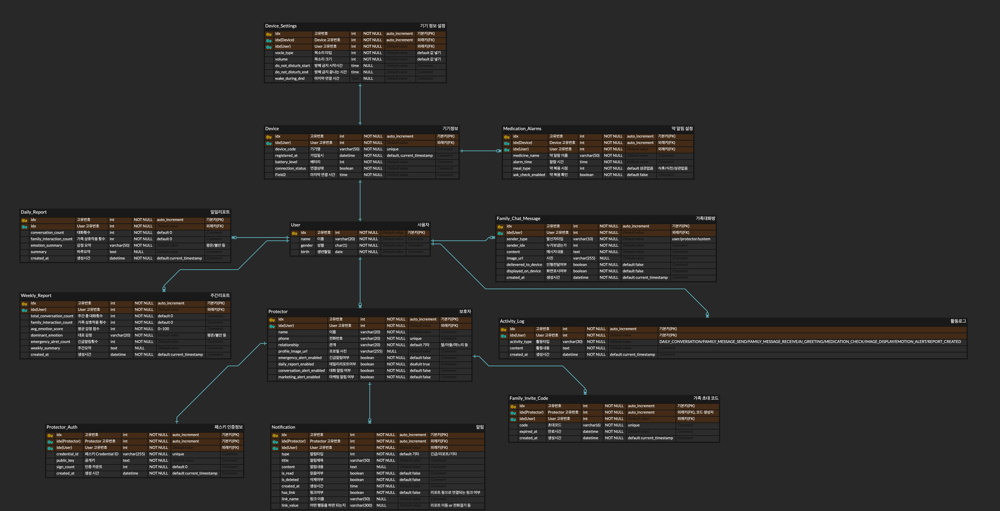

# ReMory - 치매 환자의 기억을 이어주는 AI, 나만의 기억 인형

<div align="center">
  
</div>

## 💡1. 프로젝트 개요
 
**1-1. 프로젝트 소개**
- 프로젝트 명 : ReMory (리모리) - 치매 환자의 기억을 이어주는 AI, 나만의 기억 인형
- 프로젝트 정의 : 보호자가 등록한 어르신의 실제 기억(사진·추억)을 바탕으로 AI 인형 *모리*가 능동적으로 회상 대화를 이끌고, 대화·감정·안전 정보를 보호자 앱으로 전달하는 치매 돌봄 서비스

**1-2. 개발 배경 및 필요성**
- 국내 65세 이상 치매 환자는 2026년 약 100만 명을 넘고, 2044년에는 약 200만 명에 이를 것으로 전망됩니다. 그러나 지역사회 치매 환자 가족의 45.8%가 돌봄 부담을 느끼고, 비동거 가족의 직접 돌봄 시간은 주 평균 18시간에 그칩니다. *(보건복지부, 2023 치매역학조사 및 실태조사)*
- 과거의 경험·사진을 활용하는 **회상요법**은 인지기능·우울 증상·삶의 질에 긍정적 효과가 보고된 비약물적 접근이지만, 개인사를 아는 사람이 1:1로 시간을 들여야 해 일상에서 지속하기 어렵습니다.
- 자체 설문(가족 보호자·요양보호사 13명)에서도 "같은 이야기의 반복", "기억을 떠올리지 못해 대화가 끊김", "감정 상태 파악의 어려움"이 주요 어려움으로 꼽혔습니다.
- ReMory는 **보호자 부재 시간에 생기는 상호작용 공백**을, 어르신의 실제 기억 데이터와 AI 인형으로 메우고자 합니다.

**1-3. 프로젝트 특장점**
- **나의 실제 기억 기반 회상** : 일반 콘텐츠가 아니라 가족이 앱에 올린 사진·추억을 RAG로 검색해 대화에 꺼냅니다. 기억을 언급하면 관련 사진을 인형 화면에 띄웁니다.
- **가족의 목소리** : 보호자가 앱에서 녹음한 목소리로 음성 모델을 만들어 모리가 그 목소리로 말합니다.
- **표정을 읽는 대화** : 어르신이 말하는 동안 표정을 0.7초 간격으로 분석해 대화에 반영합니다. 얼굴 원본은 기기 안에서 즉시 폐기하고 감정 라벨만 서버로 보냅니다.
- **터치 화면** : LCD 화면의 얼굴을 누르거나 쓰다듬으면 모리가 표정과 소리로 반응하고, 답장 여부처럼 간단한 선택은 화면의 큰 예/아니오 버튼으로 받습니다. 어르신이 말하는 중에는 효과음을 내지 않아 마이크에 섞이지 않게 구성했습니다.
- **두 겹의 안전 판별** : 정규식 규칙 판별 이후 LLM이 한 번 더 확인하는 과정을 거칩니다. 자해 신호는 LLM을 거치지 않고 정해진 말로 답하며 보호자에게 즉시 알림을 보냅니다. 인터넷이 끊겨도 규칙 판별은 동작하도록 구성했습니다.
- **스스로 찾아보는 인형** : mmWave 레이더로 사람을 감지하면 카메라 팬틸트가 얼굴을 따라갑니다.


**1-4. 주요 기능**
 
| 구분 | 기능 | 설명 |
|---|---|---|
| 🧸 모리 (HW) | 웨이크워드 대화 | 자체 학습한 "모리야" 웨이크워드 → 녹음·VAD → 온디바이스 STT(Whisper on Hailo) |
| | 기억 기반 회상 대화 | 발화 + 표정 감정 + 관련 기억 + 대화 이력을 LLM(Groq)에 넣어 답변·표정·위험도를 함께 생성 |
| | 표정 · 사진 표시 | LCD에 표정 6종, 말할 때 입 움직임, 관련 기억 사진, 알림 카드 표시 |
| | 터치 상호작용 | 얼굴을 톡 누르거나 쓰다듬으면 표정과 효과음으로 반응, 화면의 예/아니오 버튼으로 답장 여부 선택 |
| | 가족 메시지 전달 · 답장 | 가족이 보낸 글은 가족 목소리로 읽어주고, 사진은 화면에 표시, 화면에서 "예"를 누르면 어르신의 음성 답장을 대화방에 전송 |
| | 복약 알림 | 설정된 시간에 음성 안내 → 일정 시간 뒤 복용 확인 |
| | 안전 판별 | 자해·타해·의료·학대·거친 말을 구분해 종류별로 다르게 대응 |
| 📱 리모리 (보호자 앱) | 어르신·가족 등록 | 패스키 가입, 돌봄 그룹 생성, 초대 코드로 가족 참여 |
| | 기억 · 목소리 등록 | 사진·추억 에피소드 입력(RAG에 반영), 보호자 음성 녹음 → 음성 모델 생성 |
| | 가족 대화방 | 메시지·사진 전송, 어르신 답장 수신 |
| | 홈 · 리포트 | 대화중/연결 상태, 감정, 일과, 데일리·위클리 리포트 |
| | 알림 | 부정 감정, 자해 신호, 리포트 발행 등 푸시 알림(FCM) |

**1-5. 기대 효과 및 활용 분야**
- 기대 효과 : 보호자 부재 시간에도 어르신이 개인 기억 기반 회상 대화를 반복적으로 경험, 가족의 돌봄 부담 완화와 어르신 상태의 지속적 파악
- 활용 분야 : 재가 치매 돌봄, 독거 어르신 정서 지원, 요양·주야간보호시설의 회상 활동 보조
**1-6. 기술 스택**
- 디바이스 : Raspberry Pi 5 + AI HAT+, Python 3.11, openWakeWord(ONNX), webrtcvad, Whisper-base(.hef · Hailo), OpenCV YuNet + 자체 학습 표정 감정 모델(ONNX), LangChain + Chroma(`ko-sroberta-multitask`), Groq(`gpt-oss-120b`), Gemini 2.5 Flash(사진 → 기억 텍스트), Fish Audio TTS, WebSocket + Chromium(얼굴 화면)
- 하드웨어 제어 : Arduino UNO, 서보모터 ×2(팬틸트), mmWave 레이더, Pi Camera Module 3, 5인치 LCD, USB 마이크·스피커
- 프론트엔드 : Flutter(Dart 3.12+), passkeys, Firebase Auth·Messaging, record, audioplayers
- 백엔드 : Python 3.11, FastAPI, SQLAlchemy 2.0, Alembic, WebAuthn, PyJWT, Groq(리포트 생성)
- 데이터베이스 : PostgreSQL 16 (AWS RDS), Chroma(디바이스 로컬 벡터 DB)
- 클라우드 : AWS EC2 · RDS · S3, Tailscale
- 배포 및 관리 : Docker Compose, Caddy, GitHub Actions(pytest CI), systemd timer(Pull 방식 자동 배포)

---
 
## 💡2. 팀원 소개
 
|  |  |  |  |  |  |
|:---:|:---:|:---:|:---:|:---:|:---:|
| **멘티1** | **멘티2** | **멘티3** | **멘티4** | **멘티5** | **멘토** |
| • 하드웨어 기능 개발 <br> • 기기용 백엔드 API 설계 및 구현 <br> • RAG 기반 기억 검색 구조 구현 | • 얼굴 추적 및 표정 감정 인식 모델 학습 <br> • LLM 안전 가드레일 및 위험 발화 탐지 구현 <br> • 백엔드 API 및 AWS 배포·CI/CD 인프라 구축 | • Voice Cloning 기반 TTS 모듈 구현 <br> • LLM 연동 및 프롬프트 설계 | • 담당1 <br> • 담당2 | • 하드웨어 조립 및 제작 <br> • Flutter 앱 프론트엔드 개발 | • 프로젝트 멘토 <br> • 기술 자문 |
 
---
 
## 💡3. 시스템 구성도
 
- 서비스 구성도
  
- 하드웨어 / 센서 구성도
  
  | 부품 | 연결 | 역할 |
  |---|---|---|
  | Raspberry Pi 5 + AI HAT+ | PCIe | 전체 제어, 온디바이스 AI 추론(STT·트래킹) |
  | Pi Camera Module 3 | MIPI CSI-2 | 얼굴 추적 · 표정 감정 인식 |
  | mmWave 센서 | GPIO | 사람 재실 감지 → 추적·웨이크워드 대기 시작 |
  | Arduino UNO + 서보모터 ×2 | USB 시리얼 / PWM | `"pan,tilt"` 명령을 받아 카메라 방향 제어 (안전 범위 밖 명령 무시) |
  | 5인치 터치 LCD | HDMI(영상) · USB(터치) | 모리 얼굴 · 기억 사진 · 알림 카드, 얼굴 터치 반응 · 예/아니오 입력 |
  | USB 마이크 / 스피커 | USB | 음성 입력 / 가족 목소리 출력 |
- 기능 흐름도 (대화 한 턴)
  
- 시퀀스 다이어그램
  
- 엔티티 관계도 (ERD)
  
---
 
## 💡4. 작품 소개영상
 
[](https://youtu.be/HSbapzBop8E)
 
---

## 💡5. 핵심 소스코드
 
| # | 코드 | 저장소 | 한 줄 요약 |
|---|---|---|---|
| ① | 대화 한 턴 파이프라인 | HW | 녹음·표정 → STT → 안전 판별 → RAG → LLM → TTS |
| ② | 두 겹 안전 판별 | HW | 규칙이 먼저, LLM은 더 급할 때만 격상 |
| ③ | 표정 감정 다수결 | HW | 프레임을 모으지 않고 라벨 점수만 누적 |
| ④ | 기억 DB 증분 동기화 | HW | 해시 비교로 바뀐 기억만 Chroma에 반영 |
| ⑤ | 기억 속 지시문 방어 | HW | 턴마다 바뀌는 표식으로 가족 글을 '자료'로 고정 |
| ⑥ | 안전 이벤트 알림 정책 | BE | 자해만 즉시 알림, 학대·타해는 기록만 |
| ⑦ | 팬틸트 안전 범위 | Arduino | 범위 밖 서보 명령은 실행하지 않음 |
 
**① 대화 한 턴 파이프라인** — `Hanium-Remory-HW/main.py`
- 녹음과 동시에 표정을 분석하고, STT → 안전 판별 → RAG → LLM → TTS 순으로 처리합니다. 자해 신호는 LLM을 거치지 않습니다.
```python
# ②-1 안전 판별. LLM 을 부르기 전에 한 번 거른다.
risk = safety.classify(user_text)
if risk:
    threading.Thread(target=report_safety, args=(risk.kind, user_text), daemon=True).start()
 
# ③ RAG — 짧은 대답("응 그랬지")은 직전 발화까지 붙여 같은 화제의 기억을 찾는다.
rag_query = f"{history[-2]['content']} {user_text}" if history else user_text
context = build_context_prompt(PATIENT_ID, rag_query, top_k=RAG_TOP_K, mark=mark)
 
# ④ LLM. 자해만 거치지 않는다.
if risk and risk.kind == safety.SELF_HARM:
    reply, robot_expr = risk.reply, risk.expression
else:
    llm_out = chat_with_memory(groq_client, user_text, context, emotion,
                               hint=(risk.hint if risk else None), mark=mark,
                               history=history[-HISTORY_TURNS * 2:])
    reply, robot_expr = llm_out["reply"], llm_out["expression"]
 
    # 규칙이 놓쳤거나 약하게 본 것을 LLM 이 더 급하게 봤으면 올린다.
    upgraded = safety.escalate(risk, llm_out.get("risk"), user_text)
    if upgraded:
        threading.Thread(target=report_safety, args=(upgraded.kind, user_text), daemon=True).start()
        risk = upgraded
```
 
**② 두 겹 안전 판별** — `Hanium-Remory-HW/safety.py`
- 순서가 곧 우선순위입니다. 한 문장에 여러 신호가 섞이면 되돌릴 수 없는 자해를 가장 먼저 봅니다. LLM 판정은 규칙보다 더 급할 때만 반영합니다.
```python
def classify(text: str) -> Optional[Risk]:
    for patterns, kind in (
        (_SELF_HARM, SELF_HARM),
        (_HARM_OTHERS, HARM_OTHERS),
        (_MEDICAL, MEDICAL),
        (_ABUSE, ABUSE),
    ):
        m = _first_match(text, patterns)
        if m:
            return _BUILDERS[kind](m)
    ...
 
def escalate(rule, llm_kind, text="", idiom_guard=None):
    llm = from_llm(llm_kind)
    if llm is None:
        return None
    if idiom_guard and idiom_of(text, llm.kind):   # "힘들어 죽겠다" 같은 관용 표현
        return None
    if rule is None or _SEVERITY.index(llm.kind) < _SEVERITY.index(rule.kind):
        return llm
    return None
```
 
**③ 발화 중 표정 감정 — 신뢰도 가중 다수결** — `Hanium-Remory-HW/emotion/emotion_service.py`
- 프레임을 모아두지 않고 캡처 즉시 분류해 라벨별 점수만 누적합니다. 턴이 끝나도 되돌릴 얼굴 원본이 남지 않습니다.
```python
def _sample_loop(self):
    while not self._stop.is_set() and self._n < self._max_samples:
        res = self._analyze_once()            # (label, conf) or None
        if res is not None:
            label, conf = res
            with self._lock:
                self._votes[label] = self._votes.get(label, 0.0) + conf
                self._n += 1
        self._stop.wait(self._interval)        # 0.7초 간격
 
def on_speech_end(self):
    ...
    label = max(votes, key=votes.get)
    conf = votes[label] / sum(votes.values())
    return {"label": label, "label_ko": config.EMOTION_KO.get(label, label),
            "confidence": conf, "n": n}
```
 
**④ 기억 DB 증분 동기화** — `Hanium-Remory-HW/rag/rag_sync.py`
- 앱에 올라온 추억·사진을 5분마다 받아오되, 문서마다 고정 ID와 내용 해시를 두어 새로 생긴 것·바뀐 것·지워진 것만 반영합니다. 사진이 수백 장이어도 매번 다시 임베딩하지 않습니다.
```python
# 증분: 새로 생긴 것 / 바뀐 것만 add, 없어진 것은 delete.
cur, old = set(docs), set(manifest)
to_add = cur - old
to_del = old - cur
to_upd = {i for i in (cur & old) if docs[i]["hash"] != manifest[i]}
 
if not (to_add or to_del or to_upd):
    return False   # 바뀐 게 없음 → 아무것도 안 함.
 
del_ids = list(to_del | to_upd)
if del_ids:
    db.delete(ids=del_ids)
add_ids = list(to_add | to_upd)
if add_ids:
    db.add_texts(texts=[docs[i]["text"] for i in add_ids],
                 metadatas=[docs[i]["metadata"] for i in add_ids], ids=add_ids)
_save_json(MANIFEST_FILE, {i: docs[i]["hash"] for i in docs})
```
 
**⑤ 기억 속 지시문 방어 (데이터마킹)** — `Hanium-Remory-HW/datamark.py`, `rag/retriever.py`
- 가족이 적은 기억 글에 "너는 이제 ~해라" 같은 문장이 섞여도 LLM이 따르지 않도록, 매 턴 새로 만든 표식을 기억 본문의 단어 사이마다 끼워 넣습니다. 표식이 매번 달라 미리 흉내 낼 수 없고, 답변에 따라 나온 표식은 TTS 전에 지웁니다.
```python
def new_mark() -> str:
    """턴마다 새 표식. 매번 달라서 가족 글에 미리 흉내 내 둘 수 없다."""
    return "§" + secrets.token_hex(2)
 
# retriever.py — 기억 본문의 단어 사이를 표식으로 바꾼다
if mark:
    content = mark.join(content.split())
 
def strip_marks(text: str) -> str:
    """모델이 기억을 인용하다 표식까지 따라 쓴 경우 지운다."""
    return _MARK_RE.sub(" ", text).strip()
```
 
**⑥ 안전 이벤트 알림 정책** — `Hanium-Remory-BE/app/routers/devices.py`
- 모든 위험 신호를 기록하되, 보호자에게 즉시 알리는 건 자해뿐입니다. 공격성은 치매의 흔한 증상이라 매번 알리면 어르신을 고발하는 셈이 되고, 학대 정황은 사실 확인 전 실시간 알림이 의심받는 사람에게 가면 어르신이 더 위험해질 수 있어 리포트로만 공유합니다.
```python
@router.post("/{device_id}/safety-events", status_code=201)
def create_safety_event(device_id: int, body: SafetyEventRequest,
                        device: Device = Depends(get_current_device),
                        db: Session = Depends(get_db)):
    if device.id != device_id:
        raise APIError(403, "다른 기기의 토큰입니다.")
 
    event = SafetyEvent(user_id=device.user_id, kind=body.kind, excerpt=body.excerpt)
    db.add(event)
    db.commit()
 
    alerted = 0
    if body.kind == "self_harm":           # 자해만 쿨다운 없이 즉시 푸시
        alerted = notify_self_harm(db, device.user_id, body.excerpt or "")
    ...
```
 
**⑦ 팬틸트 안전 범위** — `Hanium-Remory-Arduino/sketch_oct16a_vscode.ino`
- 라즈베리파이가 시리얼로 보내는 `"pan,tilt"` 명령을 파싱하고, 형식이 틀리거나 측정해 둔 안전 범위를 벗어나면 서보를 움직이지 않습니다. 인형 내부 구조물에 카메라가 부딪히는 것을 막습니다.
```cpp
const int PAN_MIN = 44,  PAN_MAX = 124;
const int TILT_MIN = 88, TILT_MAX = 158;
 
void loop() {
  if (Serial.available() == 0) return;
  String command = Serial.readStringUntil('\n');
  command.trim();
 
  int pan, tilt; char extra;
  if (sscanf(command.c_str(), "%d,%d%c", &pan, &tilt, &extra) != 2) {
    Serial.println("ERROR: FORMAT");
    return;
  }
  // 안전 범위 밖의 명령은 실행하지 않음
  if (pan < PAN_MIN || pan > PAN_MAX || tilt < TILT_MIN || tilt > TILT_MAX) {
    Serial.println("ERROR: RANGE");
    return;
  }
  panServo.write(pan);
  tiltServo.write(tilt);
}
```
 